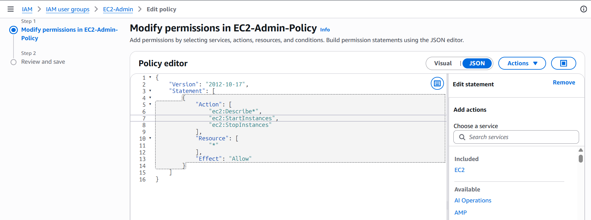
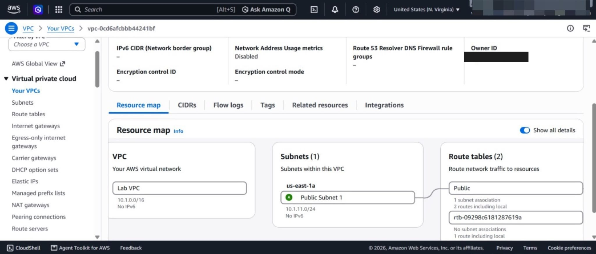
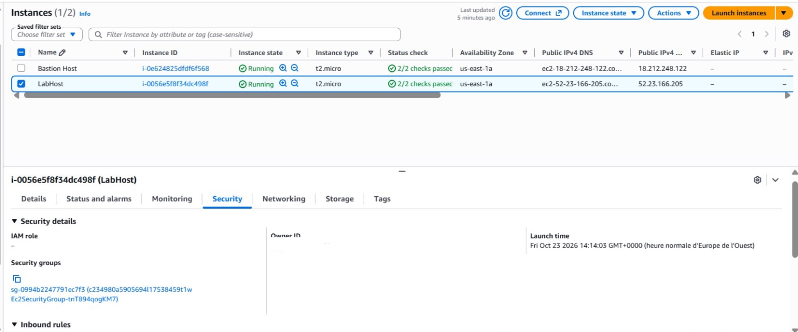

# AWS Security Lab — IAM, VPC & EC2

Hands-on lab completed during **AWS Academy Cloud Foundations**, working through
the foundational building blocks of an AWS infrastructure from a security
angle: identities, network segmentation and instance exposure.

> **Scope note.** This is a guided training lab run in an AWS Academy
> sandbox account, not a production deployment and not an
> infrastructure-as-code project. No Terraform or other IaC tool was used
> here — for an IaC-based security lab, see
> [`terraform-security-lab`](https://github.com/Ryad-Cyber/terraform-security-lab).

## Objective

Work through IAM permissions, VPC network segmentation and EC2/Security Group
configuration as presented in AWS Academy Cloud Foundations, to understand how
identity, network and instance-level controls relate to each other — and
where the lab's default configuration falls short of least privilege.

## Environment

| Component | Detail |
|---|---|
| Programme | AWS Academy Cloud Foundations |
| Region | US East (N. Virginia) |
| Account | AWS Academy Learner Lab (temporary sandbox) |

## What was actually done

### 1. IAM — permissions analysis

Reviewed and configured the `EC2-Admin-Policy` JSON policy attached to an IAM
user group (`EC2-Admin`), granting:

- `ec2:Describe*`
- `ec2:StartInstances`
- `ec2:StopInstances`

on `Resource: "*"`. The exact JSON as configured in the lab is kept in
[`docs/ec2-admin-policy.json`](docs/ec2-admin-policy.json).

**Observation.** The actions are scoped to EC2 start/stop/describe operations
(not full admin access), but the `Resource` field is left as `"*"` — i.e. the
policy applies to every EC2 resource in the account rather than a specific
instance or tag-scoped set. This is the gap flagged below under least
privilege.

### 2. VPC — network architecture

Reviewed the lab's network layout:

- **Lab VPC** — `10.1.0.0/16`
- **Public Subnet 1** — `10.1.11.0/24` (`us-east-1a`)
- **Public Route Table** — associated with the subnet above, labelled
  "Public" in the resource map

### 3. EC2 & Security Groups

Reviewed two running instances — `LabHost` and `Bastion Host` — and the
inbound rules of the Security Group attached to `LabHost`, including SSH
access on `TCP/22`.

## What this lab taught

Connecting IAM permissions, network layout and Security Group rules showed how
each control layer depends on the others — and that they don't substitute for
one another. In particular: scoping IAM **actions** (e.g. to `Start`/`Stop`
only) does not by itself enforce least privilege if the **resource** scope is
left wide open (`"*"`). A genuinely least-privilege policy here would also
constrain `Resource` to the specific instance(s) or a tag condition.

## IAM vs. least privilege — what is and isn't demonstrated

- **Demonstrated:** action-level scoping of an IAM policy (`Describe*`,
  `Start`/`StopInstances` only, not full `ec2:*`).
- **Gap identified, not fixed in this lab:** the policy's `Resource: "*"`
  means those actions apply account-wide rather than to a specific instance —
  this lab documents that gap rather than claiming it was remediated.

## Skills demonstrated

- Reading and reasoning about IAM policy JSON (actions, resources, effect).
- Identifying a least-privilege gap in an IAM policy (over-broad resource
  scope).
- Interpreting a VPC resource map: VPC, subnet, route table and their
  associations.
- Reviewing EC2 instance security configuration, including Security Group
  inbound rules.

## Limitations

- This is a **training lab inside AWS Academy's sandbox environment**, not a
  production AWS account and not an infrastructure-as-code deployment — there
  is no Terraform/CloudFormation definition to publish alongside it.
- The IAM gap identified above (`Resource: "*"`) was **documented, not
  remediated**, inside this lab.
- S3 was not part of the manipulations documented here; only IAM, VPC, EC2
  and Security Groups were reviewed and are backed by screenshots.
- Screenshots in this repository have the AWS account ID redacted; all other
  details (IPs, security group IDs, instance IDs) are as shown in the AWS
  Academy sandbox and are not reachable outside that temporary environment.

## Portfolio

Full write-up and context: [ryad-cyber.github.io](https://ryad-cyber.github.io/#p-aws)
